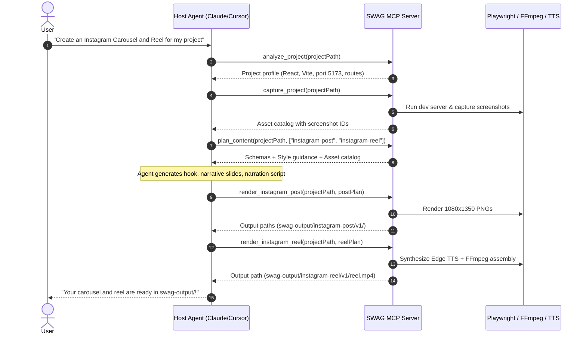

# SWAG 🕶️ — Developer Social Media Engine

> **Universal MCP Server that turns portfolio projects into publishable social media content.**  
> Compatible with **Claude Code**, **Cursor**, **Windsurf**, **VS Code Copilot**, **Zed**, **Cline**, and any MCP-compliant client.

---

## 🌟 What is SWAG?

**SWAG** solves the developer showcase dilemma. As developers, we build projects but struggle to create polished, high-engagement content for social media. 

SWAG operates as a **Model Context Protocol (MCP)** server on `stdio`. It hooks into your agentic IDE, inspects your web repository, spins up the dev server, captures pixel-perfect responsive screenshots and recordings, and renders publication-ready assets:

1. 📸 **Instagram Posts & Carousels** — 1080×1350 portrait PNG slides with glassmorphic cards, typography, tech badges, and device frames.
2. 📱 **Instagram Reels** — 1080×1920 9:16 vertical short-form videos with synchronized keyless TTS voiceover, animated captions, and safe-zone compliance.
3. 🎥 **YouTube Walkthroughs** — 1920×1080 16:9 widescreen long-form videos with synchronized voiceover, video chapters, `.srt` subtitle files, and markdown scripts.
4. 🖥️ **Interactive Web GUI** — A local dashboard (`http://localhost:8420`) to inspect assets, preview themes, verify WCAG AA color contrast, and browse past versions.

---

## 📐 Core Architecture & Hard Rules

- **Zero LLM Calls Inside SWAG:** Creative reasoning, copywriting, hooks, and narration scripts are crafted by **your host agent's LLM** using your existing agent credits. SWAG returns typed schemas via `plan_content`, your agent fills them, and SWAG validates and renders the media.
- **Zero Required API Keys:** High-quality voice synthesis is powered out-of-the-box by Microsoft Edge TTS (`node-edge-tts`) without any paid accounts or API keys.
- **Pristine MCP Stdio Transport:** All diagnostic and info logs are strictly routed to `stderr` via a structured logger, keeping `stdout` 100% clean for JSON-RPC MCP messages.
- **Privacy First:** Automatic DOM & regex scanning blurs exposed API keys, JWTs, emails, and database connection strings before capturing screenshots or videos.
- **Non-Overwriting Versioning:** Renders are preserved in `swag-output/<platform>/vN/` with a complete `metadata.json` audit trail.

---

## 🚀 Quick Start

### 1. Installation

```bash
# Clone the repository
git clone https://github.com/ankit-ambasta/SWAG.git
cd SWAG

# Install dependencies
npm install

# Build the MCP server
npm run build
```

### 2. Standalone Web Dashboard (Optional)

You can launch the SWAG Web Studio directly in your browser:

```bash
# Launch for current directory
npm run start -- --gui

# Or specify a project path and port
npm run start -- --gui /path/to/my-project --port 8420
```

---

## 🔌 MCP Client Configuration

### Claude Code
Add to your project's `.mcp.json` or `~/.claude/mcp.json`:
```json
{
  "mcpServers": {
    "swag": {
      "command": "node",
      "args": ["/absolute/path/to/SWAG/dist/index.js"]
    }
  }
}
```

### Cursor (`~/.cursor/mcp.json` or `.cursor/mcp.json`)
```json
{
  "mcpServers": {
    "swag": {
      "command": "node",
      "args": ["/absolute/path/to/SWAG/dist/index.js"]
    }
  }
}
```

### Windsurf (`~/.codeium/windsurf/mcp_config.json`)
```json
{
  "mcpServers": {
    "swag": {
      "command": "node",
      "args": ["/absolute/path/to/SWAG/dist/index.js"]
    }
  }
}
```

### Zed (`~/.config/zed/settings.json`)
```json
{
  "context_servers": [
    {
      "id": "swag",
      "command": "node",
      "args": ["/absolute/path/to/SWAG/dist/index.js"]
    }
  ]
}
```

---

## 🛠️ MCP Tools Reference

SWAG exposes **13 specialized MCP tools**:

### 1. Project Analysis & Server Control
- **`analyze_project`**: Inspects package manifests, Python requirements, and READMEs. Detects frameworks (Next.js, Vite, React, Vue, Svelte, Astro, FastAPI, Flask, Streamlit), ports, and start scripts.
- **`capture_project`**: Manages dev server lifecycle (auto-detects open port, polls readiness), navigates pages via Playwright, blurs secrets, and saves screenshots/recordings to `.swag/assets/`.

### 2. Asset Management
- **`list_assets`**: Queries `.swag/catalog.json` filtering by asset type (`screenshot`, `recording`, `image`), route, or source.
- **`add_asset`**: Imports user-supplied screenshots, logos, or video clips into the project catalog.

### 3. Theming & Brand Identity
- **`get_theme`**: Detects current theme (auto-discovers VS Code / Cursor / Zed active themes) and runs WCAG AA contrast validation.
- **`set_theme`**: Updates design tokens (colors, typography, radii) or applies presets (`dark`, `light`).
- **`get_brand_kit` / `set_brand_kit`**: Manages developer handle, avatar, logo, font, and outro configurations across project or global (`~/.swag/brand.json`) scopes.
- **`get_style_presets`**: Lists voice & tone presets (`Professional`, `Casual`, `Minimalist`, `Artistic`, `Humorous`).

### 4. Content Planning & Rendering
- **`plan_content`**: The creative handoff! Returns the exact schema your host agent needs to fill, paired with project context, available asset IDs, and style guidance.
- **`render_instagram_post`**: Takes an agent-filled `PostPlan` and generates 1080×1350 PNG slides with browser frames and typography.
- **`render_instagram_reel`**: Takes an agent-filled `ReelPlan`, generates Edge TTS audio, animates card layouts, and outputs a 1080×1920 MP4 video.
- **`render_youtube_video`**: Takes a `YouTubeVideoPlan`, synthesizes voiceover, and exports 16:9 `video.mp4`, `subtitles.srt`, YouTube chapter markers, and `script.md`.

### 5. Outputs & Studio GUI
- **`list_outputs`**: Lists version history, generated files, and metadata summaries across all platforms.
- **`open_gui`**: Launches the local interactive web dashboard and returns the URL.

---

## 🎨 Content Generation Workflow



---

## ⚙️ Configuration (`swag.config.json`)

Customize project defaults by placing a `swag.config.json` in your repository root:

```json
{
  "defaultStyle": "professional",
  "output": {
    "directory": "swag-output"
  },
  "content": {
    "defaultSlideCount": 5,
    "hashtagCount": 15,
    "deviceFrame": "browser",
    "narrationLanguage": "en"
  },
  "tts": {
    "provider": "edge-tts",
    "voice": "en-US-ChristopherNeural",
    "speed": 1.0
  }
}
```

---

## 🧪 Testing

SWAG includes a comprehensive unit test suite covering detectors, Playwright capture, contrast validation, video rendering, and TTS:

```bash
# Run all unit tests
npm test

# Run tests in watch mode
npm run test:watch

# Run TypeScript type check
npm run lint
```

---

## 📄 License

MIT © Ankit Ambasta
